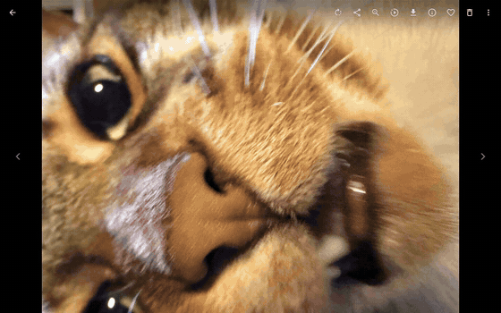
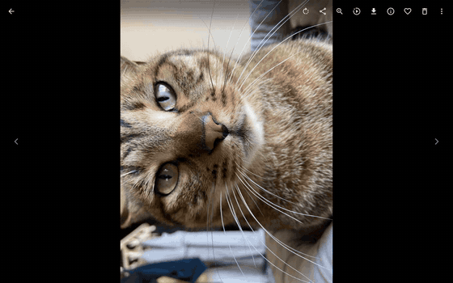

# Immich 实况照片无损旋转

[English](README.md)

一个油猴脚本：在 [Immich](https://immich.app) 网页端旋转 iPhone 实况照片，照片和动态视频一起转，无损。Immich 自带的编辑器做不到（[immich#28480](https://github.com/immich-app/immich/issues/28480)）。

 

## 安装

1. 装 [Tampermonkey](https://www.tampermonkey.net/) 或 [Violentmonkey](https://violentmonkey.github.io/)。Chrome 还要在扩展详情页打开「允许用户脚本」。
2. 打开 [immich-live-rotate.user.js](https://raw.githubusercontent.com/vinci7/immich-live-rotate/main/immich-live-rotate.user.js)，安装。

## 使用

打开一张实况照片，点工具栏的旋转按钮（每点一次多转 90°），再点「确认旋转」。点别处或按 <kbd>Esc</kbd> 取消。

原照片默认叠在新版本下面；可以在脚本管理器的菜单里改成「放进回收站」。

## 须知

- 旋转会生成一张新照片。收藏、描述、评分、相册、标签会复制过去；在 Immich 里改过的日期或地点、分享链接、评论不会复制，人脸会重新识别。
- Immich 的域名各不相同，所以脚本匹配所有网站，只在 `/api/server/ping` 像 Immich 那样响应时才启用。可以在脚本管理器里把它限定到你的 Immich 地址。
- 只支持 iPhone 的 HEIC 实况照片，一次一张，只能转自己的照片。
- 在 Immich v3.4.0 + Chrome 上测过。Immich 更新后按钮不见了，请[提 issue](https://github.com/vinci7/immich-live-rotate/issues)。

## 原理

方向是元数据，只需改几个字节：HEIC 的 `irot` 和 EXIF Orientation（HDR 增益图保持对位），MOV 的 `tkhd` 矩阵。两边换一个新的 `ContentIdentifier`，免得 Immich 把原照片配到新视频上。改好后用你的登录状态通过 Immich 接口上传。

用自己的文件测核心逻辑：`node test/core.test.cjs photo.heic video.mov`。

## 许可证

[MIT](LICENSE)。与 Immich 官方无关。
