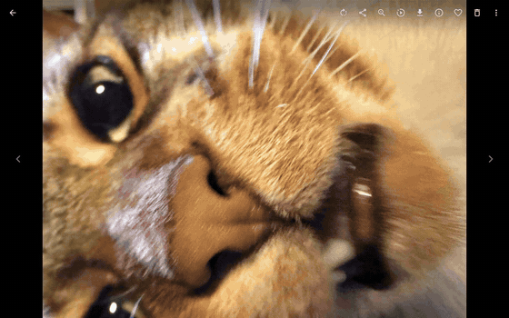

Rotate iPhone Live Photos in the [Immich](https://immich.app) web UI — photo and motion video together, losslessly. Immich's own editor can't do this ([immich#28480](https://github.com/immich-app/immich/issues/28480)).

## Use

Open a Live Photo, click the rotate button in the toolbar (each click adds 90°), then **Rotate**. Click elsewhere or press Esc to cancel.

The original is stacked under the new version by default; switch to "move to trash" in the userscript manager's menu.

In Chrome, enable **Allow User Scripts** on your userscript manager's extension details page, or the script won't run.

## Good to know

- Rotating creates a new asset. Favorite, description, rating, albums and tags are copied; date or location edits made in Immich, shared links and comments are not, and faces are re-detected.
- The script matches all sites because Immich runs on any domain, and only activates where `/api/server/ping` answers like Immich. You can restrict it to your Immich URL in the userscript manager.
- HEIC Live Photos from iPhone only, one at a time, your own photos only.
- Tested on Immich v3.4.0 with Chrome. If the button disappears after an Immich update, please [open an issue](https://github.com/vinci7/immich-live-rotate/issues).

Source, details and a Chinese README: [github.com/vinci7/immich-live-rotate](https://github.com/vinci7/immich-live-rotate)
